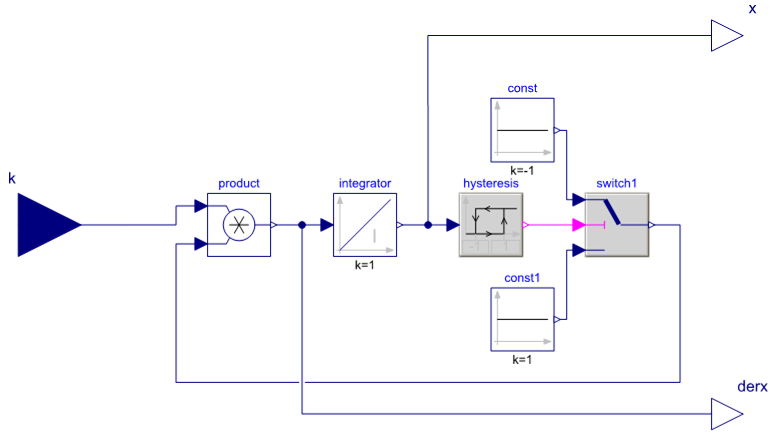
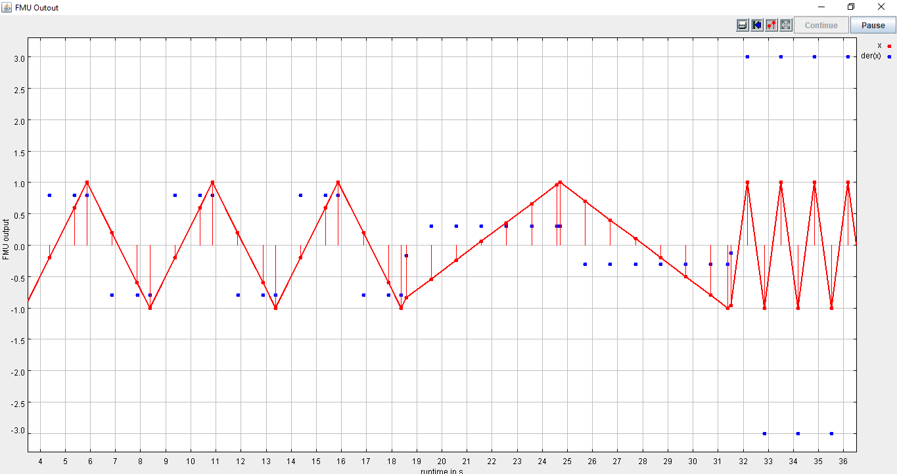
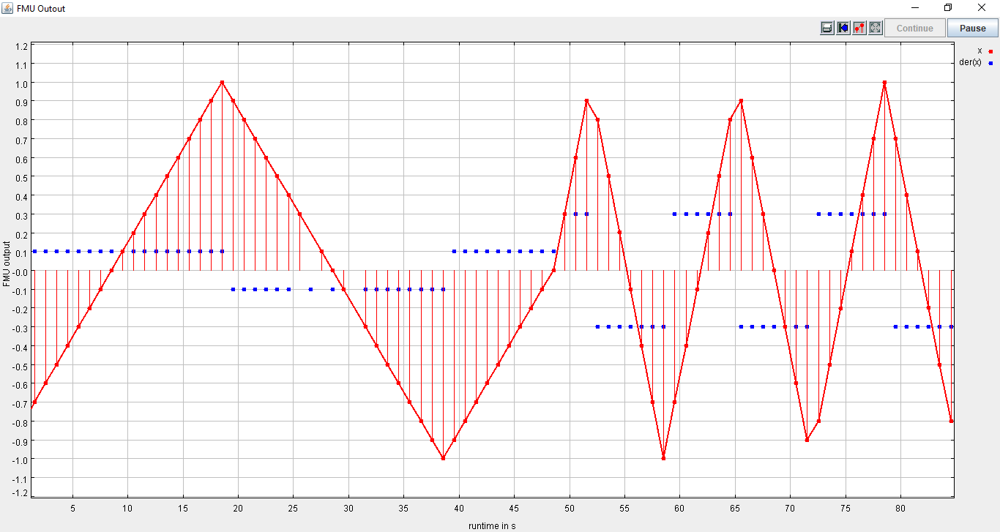

Prerequisites
=============

The examples run with Docker Compose.
These images are published on Docker Hub and are pulled automatically:

* ``ait1/lablink-config-server:latest``
* ``ait1/lablink-datapoint-bridge:latest``
* ``ait1/lablink-plotter:latest``
* ``ait1/lablink-fmusim:latest``
* ``eclipse-mosquitto:2``

Both examples publish the configuration server on port ``10101`` and the plotter on port ``8080``, so run only one of them at a time.

The zigzag model is the unpacked Linux FMU at :github_tree:`src/test/resources/zigzag-linux64 <src/test/resources/zigzag-linux64>`.
The simulator loads an FMU, so each Compose file packs that directory to ``/tmp/zigzag.fmu`` before the client starts.
In the example configurations, that URI is ``file:///tmp/zigzag.fmu``.

.. note:: Once a stack is running, the available configurations are listed at http://localhost:10101.

.. seealso:: A convenient tool for viewing the content of the configuration database file (and editing it for experimenting with the examples) is `DB Browser for SQLite <https://sqlitebrowser.org/>`_.

Example 1: Dynamic simulation using an FMU for Model Exchange
=============================================================

The figure below shows the graphical representation of the *zigzag* model used in this example.
It comprises an integrator, whose input is a constant (model input variable ``k``), and a hysteresis controller, which switches the sign of ``k`` in case the integrator's output variable ``x`` crosses a certain threshold (low: -1, high: 1).
The resulting output is a zigzag pattern (hence the model name).
The model has been compiled with `Dymola <https://en.wikipedia.org/wiki/Dymola>`__ into an FMU for Model Exchange.

The client is ``DynamicFmuModelExchangeAsync``.
Its configuration is ``ait.test.fmusim.dynamic_me.fmu.config``.

The example setup is configured via the Compose file at :github_blob:`examples/1_dynamic_me/docker-compose.yml <examples/1_dynamic_me/docker-compose.yml>`.
Using a local clone of the repository, change to folder `examples/1_dynamic_me` and start the MQTT broker, the configuration server, the datapoint bridge, and the plotter:

.. code-block:: bash

   docker compose up -d

The plotter window is accessible at http://localhost:8080.

Start the FMU simulator shell in its own terminal, from the same directory.
The shell is the service ``fmusim`` and is not started by ``docker compose up``.

.. code-block:: bash

   docker compose run --rm --no-tty=false fmusim

Once the FMU simulator client starts up, the client shell can be used to interact with the FMU model.
For instance, input variable ``k`` of the FMU model can be changed:

.. code-block:: doscon

   llclient> svd k .3
   Success
   llclient> svd k 3
   Success

An example of how the FMU reacts on these inputs can be seen in the following figure.

Example 2: Fixed-step simulation using an FMU for Model Exchange
================================================================

This example uses the same *zigzag* model as the previous example.
The client is ``FixedStepFmuModelExchangeAsync``.
Its configuration is ``ait.test.fmusim.fixedstep_me.fmu.config``.

The Compose file is :github_blob:`examples/2_fixedstep_me/docker-compose.yml <examples/2_fixedstep_me/docker-compose.yml>`.
From :github_tree:`examples/2_fixedstep_me`:

.. code-block:: bash

   docker compose up -d

.. code-block:: bash

   docker compose run --rm --no-tty=false fmusim

The plotter window is at http://localhost:8080.
Once the FMU simulator client starts up, the client shell can be used to interact with the FMU model.
For instance, input variable ``k`` of the FMU model can be changed:

.. code-block:: doscon

   llclient> svd k 0.3
   Success

An example of how the FMU reacts on these inputs can be seen in the following figure.
Notice the differences to the previous example, where the FMU simulator did update the outputs not only at strictly periodic intervals.

